# Test Cases

## Preconditions (apply to all test cases unless stated otherwise)

- LabDesk is accessible at https://wh-qa-test.wizardhealth.workers.dev/
- Browsers: Google Chrome and Brave, OS: Windows 11
- Page is freshly loaded; Worklist shows 4 samples (2608-0142, 2608-0140, 2608-0138, 2608-0135)
- Tested samples are in status "NEW" (not approved), unless the test case states otherwise
- No unsaved edits remain from previous test cases (page refreshed before each test)

---

| ID | Summary | Priority | Severity | Status |
|----|---------|----------|----------|--------|
| [TC01](#tc01) | Verify LabDesk worklist displays sample entries | High | High | ✅ Passed |
| [TC02](#tc02) | Verify selecting a sample from worklist opens its record | High | High | ✅ Passed |
| [TC03](#tc03) | Verify all patient header fields are displayed | High | High | ✅ Passed |
| [TC04](#tc04) | Verify sample barcode panel (image + label) is displayed | Medium | High | ✅ Passed |
| [TC05](#tc05) | Verify CBC panel title and sample reference are displayed | Medium | Medium | ✅ Passed |
| [TC06](#tc06) | Verify all CBC panel table columns are displayed | High | High | ✅ Passed |
| [TC07](#tc07) | Verify Result fields are editable input boxes | High | High | ✅ Passed |
| [TC08](#tc08) | Verify Result field rejects non-numeric input | Low | Medium | ❌ Failed |
| [TC09](#tc09) | Verify Comment field is editable | High | High | ✅ Passed |
| [TC10](#tc10) | Verify Blood type drop down selection works | High | High | ✅ Passed |
| [TC11](#tc11) | Verify barcode from worklist matches barcode in patient header and barcode on sample label and barcode panel | High | High | ❌ Failed |
| [TC12](#tc12) | Verify that result field edits are isolated per sample | High | High | ❌ Failed |
| [TC13](#tc13) | Verify that Blood type field edits are isolated per sample | High | High | ❌ Failed |
| [TC14](#tc14) | Verify that Comment field edits are isolated per sample | High | High | ❌ Failed |
| [TC15](#tc15) | Verify border values for FLAG value | High | High | ❌ Failed |
| [TC16](#tc16) | Verify FLAG value correctly reflects Result vs Ref. Range | High | High | ❌ Failed |
| [TC17](#tc17) | Verify Collected date/time is not later than current system date | Low | Medium | ❌ Failed |
| [TC18](#tc18) | Verify that age of patients are correctly displayed | Medium | High | ❌ Failed |
| [TC19](#tc19) | Verify search field returns correct sample when searching by name | Medium | Medium | ✅ Passed |
| [TC20](#tc20) | Verify search field returns correct sample when searching by barcode number | Medium | Medium | ✅ Passed |
| [TC21](#tc21) | Verify each analysis appears only once per panel | Medium | Medium | ❌ Failed |
| [TC22](#tc22) | Verify Ref. Range matches patient's Sex | High | High | ❌ Failed |
| [TC23](#tc23) | Verify Flag is correctly applied based on Sex Ref. Range | High | High | ✅ Passed |
| [TC24](#tc24) | Verify Save and Approve buttons position while scrolling | Low | Low | ❌ Failed |
| [TC25](#tc25) | Verify that a record can be approved when all Result fields are populated | High | High | ✅ Passed |
| [TC26](#tc26) | Verify that a sample can't be approved with empty field | High | High | ❌ Failed |
| [TC27](#tc27) | Verify Results fields are non-editable after sample approval | Medium | Medium | ✅ Passed |
| [TC28](#tc28) | Verify that the sample status changes after approval | Low | Medium | ⚠️ Pass with Exception |
| [TC29](#tc29) | Verify sample cannot be Approved when a field contains a non-numeric value | Low | Medium | ❌ Failed |
| [TC30](#tc30) | Verify that "Print" button works properly  | High | High | ❌ Failed |
| [TC31](#tc31) | Verify that "Return to work" button works properly | High | High | ✅ Passed |
| [TC32](#tc32) | Verify that a single edit is saved after Refresh | High | High | ❌ Failed |
| [TC33](#tc33) | Verify that a single edit is retained when navigating away and back (without refresh) | High | High | ❌ Failed |
| [TC34](#tc34) | Verify that multiple edits on the same sample are all saved after Refresh | High | High | ❌ Failed |
| [TC35](#tc35) | Verify that multiple edits on the same sample are all retained without Refresh | High | High | ❌ Failed |
| [TC36](#tc36) | Verify that multiple edits across samples are saved independently after Refresh | High | High | ❌ Failed |
| [TC37](#tc37) | Verify that multiple edits across samples are retained independently without Refresh | High | High | ❌ Failed |
| [TC38](#tc38) | Verify data consistency of results list after page reload | Medium | High | ✅ Passed |
| [TC39](#tc39) | Verify data consistency of results list after editing, saving, and refreshing the page | High | High | ❌ Failed |
| [TC40](#tc40) | Verify edits in Tab 1 on Sample A do not leak into Tab 2 on Sample B | High | High | ✅ Passed |
| [TC41](#tc41) | Verify edits in Browser 1 on Sample A do not leak into Browser 2 on Sample B | High | High | ✅ Passed |
| [TC42](#tc42) | Verify Tab 2 pulls the latest saved value after refresh when the same sample is edited in Tab 1 | High | High | ❌ Failed |
| [TC43](#tc43) | Verify Browser 2 pulls the latest saved value after refresh when the same sample is edited in Browser 1 | High | High | ❌ Failed |
| [TC44](#tc44) | Verify that all sequential single-field edit/save cycles are retained on the same sample (without refresh) | High | High | ❌ Failed |
| [TC45](#tc45) | Verify sequential single-field edit/save cycles are all retained with a refresh between each cycle | High | High | ❌ Failed |
| [TC46](#tc46) | Verify behavior when the same field on the same sample is edited and saved concurrently from two tabs | High | High | ❌ Failed |
| [TC47](#tc47) | Verify behavior when the same field on the same sample is edited and saved concurrently from two browsers | High | High | ❌ Failed |
| [TC48](#tc48) | Verify that an unsaved edit is discarded when navigating away and back without clicking Save | High | High | ❌ Failed |
| [TC49](#tc49) | Verify clicking Save with no changes made does not cause errors or unintended side effects | Low | Low | ✅ Passed |
| [TC50](#tc50) | Verify Blood type is non-editable after sample approval | Medium | Medium | ✅ Passed |
| [TC51](#tc51) | Verify Comment field is non-editable after sample approval | Medium | Medium | ✅ Passed |
| [TC52](#tc52) | Verify refreshing the page immediately after clicking Save does not cause data loss | High | High | ❌ Failed |
| [TC53](#tc53) | Verify sample cannot be approved when a field contains negative numeric value | High | High | ❌ Failed |

---

## TC01: Verify LabDesk worklist displays sample entries

| Status | Priority | Severity | Date | Environment |
|--------|----------|----------|------|-------------|
| ✅ Passed | High | High | 21.08.2026 | Browser: Brave, Google Chrome · OS: Windows 11 |

**Steps to reproduce:**

1. Open the LabDesk application
2. Observe the Worklist panel on the left side

**Expected result:**

Worklist should load and display a list of samples, each showing a status indicator, sample barcode and patient name

**Actual result:**

Worklist loads correctly, displaying 4 samples (2608-0142 Ana Marić, 2608-0140 John Smith, 2608-0138 Faruk Hodžić, 2608-0135 Maria Rossi) with orange status dots

---

## TC02: Verify selecting a sample from worklist opens its record

| Status | Priority | Severity | Date | Environment |
|--------|----------|----------|------|-------------|
| ✅ Passed | High | High | 21.08.2026 | Browser: Brave, Google Chrome · OS: Windows 11 |

**Steps to reproduce:**

1. Open LabDesk application
2. Click on sample "2608-0142 Ana Marić" in the Worklist

**Expected result:**

The selected sample's record should open in the main panel, displaying patient header info, CBC panel, barcode, Save and Approve buttons

**Actual result:**

The selected sample's record is displayed in the main panel, displaying patient header info, CBC panel, barcode, Save and Approve buttons

---

## TC03: Verify all patient header fields are displayed

| Status | Priority | Severity | Date | Environment |
|--------|----------|----------|------|-------------|
| ✅ Passed | High | High | 21.08.2026 | Browser: Brave, Google Chrome · OS: Windows 11 |

**Steps to reproduce:**

1. Open sample record 2608-0142 (Ana Marić)
2. Review the header section below the patient name
3. Check for presence of: Sex, Age, DOB, Barcode, Collected date/time, Sender, status badge

**Expected result:**

All listed fields should be displayed with valid, non-empty values

**Actual result:**

All fields are displayed : Sex: F, Age: 34y, DOB: 14 Mar 1991, Barcode: 2608-0142, Collected: 21 Aug 2026 08:14, Sender: Dr. E. Petrović, badge: NEW

---

## TC04: Verify sample barcode panel (image + label) is displayed

| Status | Priority | Severity | Date | Environment |
|--------|----------|----------|------|-------------|
| ✅ Passed | Medium | High | 21.08.2026 | Browser: Brave, Google Chrome · OS: Windows 11 |

**Related test cases:** [TC11](#tc11)

**Steps to reproduce:**

1. Open sample record 2608-0142 (Ana Marić)
2. Observe the barcode panel in the top-right of the screen
3. Check for presence of: barcode image, barcode number, sample type, patient name

**Expected result:**

All elements should be displayed: scannable barcode image, barcode number, sample type (e.g., EDTA), patient name

**Actual result:**

All elements are displayed : barcode image, number 2608-0412, "EDTA · ANA MARIC" label

**Additional notes:**

- The barcode number is displayed, but it does not match the one covered in another TC.

---

## TC05: Verify CBC panel title and sample reference are displayed

| Status | Priority | Severity | Date | Environment |
|--------|----------|----------|------|-------------|
| ✅ Passed | Medium | Medium | 21.08.2026 | Browser: Brave, Google Chrome · OS: Windows 11 |

**Steps to reproduce:**

1. Open sample record 2608-0142 (Ana Marić)
2. Observe the CBC panel section header

**Expected result:**

Panel title ("CBC panel") and associated sample ID ("Sample [barcode]") should be displayed

**Actual result:**

"CBC panel" title and "Sample 2608-0142" are both displayed correctly

---

## TC06: Verify all CBC panel table columns are displayed

| Status | Priority | Severity | Date | Environment |
|--------|----------|----------|------|-------------|
| ✅ Passed | High | High | 21.08.2026 | Browser: Brave, Google Chrome · OS: Windows 11 |

**Steps to reproduce:**

1. Open sample record 2608-0142 (Ana Marić)
2. Review the CBC panel table header row

**Expected result:**

Table should display columns: ANALYSIS, RESULT, UNIT, REF. RANGE, FLAG

**Actual result:**

All five column headers are displayed correctly

---

## TC07: Verify Result fields are editable input boxes

| Status | Priority | Severity | Date | Environment |
|--------|----------|----------|------|-------------|
| ✅ Passed | High | High | 21.08.2026 | Browser: Brave, Google Chrome · OS: Windows 11 |

**Steps to reproduce:**

1. Open sample record 2608-0142 (Ana Marić)
2. Click on a Sodium Result field
3. Enter "13"

**Expected result:**

Result field should be an editable input box allowing value entry/modification

**Actual result:**

Result field is editable, "13" is entered

---

## TC08: Verify Result field rejects non-numeric input

| Status | Priority | Severity | Date | Environment |
|--------|----------|----------|------|-------------|
| ❌ Failed | Low | Medium | 23.08.2026 | Browser: Brave, Google Chrome · OS: Windows 11 |

**Connected bugs:** [BR01](bug-reports.md#br01)

**Steps to reproduce:**

1. Open sample record 2608-0140 (John Smith)
2. Click on a Sodium Result field
3. Enter "te12#$%"

**Expected result:**

Field rejects the non-numeric entry and shows an error message stating a numeric value is required.

**Actual result:**

"te12#$%" is entered in the field

**Screenshot:**

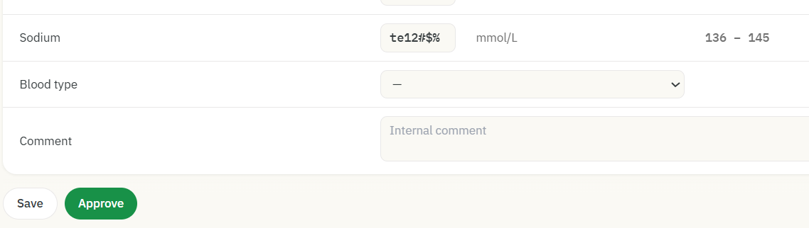

---

## TC09: Verify Comment field is editable

| Status | Priority | Severity | Date | Environment |
|--------|----------|----------|------|-------------|
| ✅ Passed | High | High | 23.08.2026 | Browser: Brave, Google Chrome · OS: Windows 11 |

**Steps to reproduce:**

1. Open sample record 2608-0140 (John Smith)
2. Click on a Comment field
3. Enter "Test123"

**Expected result:**

Comment field is editable and "Test123" is displayed

**Actual result:**

Comment field is editable and "Test123" is displayed

---

## TC10: Verify Blood type drop down selection works

| Status | Priority | Severity | Date | Environment |
|--------|----------|----------|------|-------------|
| ✅ Passed | High | High | 23.08.2026 | Browser: Brave, Google Chrome · OS: Windows 11 |

**Steps to reproduce:**

1. Open sample record 2608-0140 (John Smith)
2. Click on a Blood type drop down
3. Verify all blood type options are present (A+, A-, B+, B-, AB+, AB-, O+, O-)
4. Select "O+"

**Expected result:**

All blood type options are present, "O+" is selected

**Actual result:**

All blood type options are present, "O+" is selected

---

## TC11: Verify barcode from worklist matches barcode in patient header and barcode on sample label and barcode panel

| Status | Priority | Severity | Date | Environment |
|--------|----------|----------|------|-------------|
| ❌ Failed | High | High | 21.08.2026 | Browser: Brave, Google Chrome · OS: Windows 11 |

**Connected bugs:** [BR02](bug-reports.md#br02)

**Related test cases:** [TC04](#tc04)

**Steps to reproduce:**

1. Open sample record 2608-0142 (Ana Marić)
2. Compare barcode value in worklist (2608-0142) with the number printed under the barcode image (top-right panel), and barcode in patient header and barcode on sample label

**Expected result:**

All 4 values are identical

**Actual result:**

Barcodes from worklist, sample label and patient header are identical but barcode number below barcode image are different

**Screenshot:**

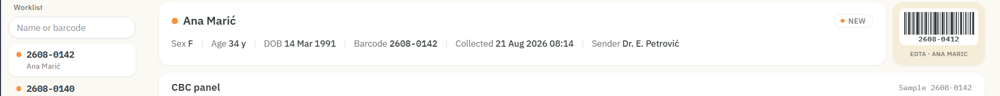

---

## TC12: Verify that result field edits are isolated per sample

| Status | Priority | Severity | Date | Environment |
|--------|----------|----------|------|-------------|
| ❌ Failed | High | High | 22.08.2026 | Browser: Brave, Google Chrome · OS: Windows 11 |

**Connected bugs:** [BR03](bug-reports.md#br03), [BR15](bug-reports.md#br15)

**Related test cases:** [TC35](#tc35), [TC13](#tc13), [TC14](#tc14), [TC33](#tc33), [TC37](#tc37), [TC44](#tc44), [TC48](#tc48)

**Steps to reproduce:**

1. Open sample 2608-0140 (Sample B), check WBC and RBC values
2. Open sample 2608-0142 (Sample A), check WBC and RBC values
3. Edit WBC value for Sample A, click Save
4. Verify: WBC for Sample A shows new value and is saved
5. Open Sample B, check WBC value
6. Verify: WBC for Sample B is unchanged
7. Go back to Sample A, edit RBC value, click Save
8. Verify: RBC for Sample A shows new value and is saved
9. Open Sample B, check WBC and RBC values
10. Verify: WBC and RBC for Sample B are both unchanged

**Expected result:**

Both WBC and RBC are edited and saved correctly for Sample A. Nothing changes for Sample B at any point.

**Actual result:**

Values are edited and saved correctly for Sample A. For Sample B, WBC initially picks up the value edited on Sample A but reverts back to its original value once RBC is edited on Sample A RBC then shows Sample A's edited value instead of Sample B's own.

**Additional notes:**

- This behavior is confirmed in both direction (Sample B -&gt; Sample A).
- Sample B does not need to be in the work or modified directly. Editing a field on Sample A changes the value to Sample B, even if Sample B has status "Approved".
- The fact that the original leaked value reverts back while the newly edited value now leaks instead is a direct result of the Save button bug, which is described in TC35

**Video:** [TC12.mp4](https://github.com/MonikaPejkanovic/manual_testing_project/raw/main/evidence/videos/TC12.mp4)

---

## TC13: Verify that Blood type field edits are isolated per sample

| Status | Priority | Severity | Date | Environment |
|--------|----------|----------|------|-------------|
| ❌ Failed | High | High | 22.08.2026 | Browser: Brave, Google Chrome · OS: Windows 11 |

**Connected bugs:** [BR03](bug-reports.md#br03)

**Related test cases:** [TC12](#tc12), [TC14](#tc14)

**Steps to reproduce:**

1. Open Sample 2608-0140 (Sample B), check Blood type
2. Go to Sample A and select different Blood type from Sample B blood type from drop down
3. Click on "Save"
4. Open sample B and verify Blood type field is unchanged
5. Change blood type field for sample B to "-"
6. Click on "Save"
7. Go to sample A and verify Blood type field is unchanged

**Expected result:**

Blood type field edits are isolated per patient

**Actual result:**

Blood type field edits of Sample A are affecting Blood type field of Sample B and the other way around

**Additional notes:**

- Editing a field on one sample changes the value to the other sample, even if other sample has status "Approved".

**Video:** [TC13.mp4](https://github.com/MonikaPejkanovic/manual_testing_project/raw/main/evidence/videos/TC13.mp4)

---

## TC14: Verify that Comment field edits are isolated per sample

| Status | Priority | Severity | Date | Environment |
|--------|----------|----------|------|-------------|
| ❌ Failed | High | High | 22.08.2026 | Browser: Brave, Google Chrome · OS: Windows 11 |

**Connected bugs:** [BR03](bug-reports.md#br03)

**Related test cases:** [TC12](#tc12), [TC13](#tc13)

**Steps to reproduce:**

1. Open Sample 2608-0140 (Sample B), check Comment field
2. Go to Sample 2608-0142 (Sample A) and enter "test" in Comment field
3. Click on "Save"
4. Open Sample B and verify Comment field is unchanged and enter "abc" in Comment field
5. Click on "Save"
6. Go to sample A and verify Comment field is unchanged

**Expected result:**

Comment field edits are isolated per patient

**Actual result:**

Comment field edits of Sample A are affecting Comment field of Sample B and the other way around

**Additional notes:**

- Editing a field on one sample changes the value to the other sample, even if other sample has status "Approved".

**Video:** [TC14.mp4](https://github.com/MonikaPejkanovic/manual_testing_project/raw/main/evidence/videos/TC14.mp4)

---

## TC15: Verify border values for FLAG value

| Status | Priority | Severity | Date | Environment |
|--------|----------|----------|------|-------------|
| ❌ Failed | High | High | 24.08.2026 | Browser: Brave, Google Chrome · OS: Windows 11 |

**Connected bugs:** [BR04](bug-reports.md#br04)

**Related test cases:** [TC16](#tc16), [TC21](#tc21)

**Steps to reproduce:**

1. Open sample record 2608-0142 (Ana Marić).
2. For each analysis row, enter Result values around the normal range boundaries, first using a 1.0 increment:
   - 1.0 below the minimum normal range
   - exactly at the minimum normal range
   - 1.0 above the minimum normal range
   - 1.0 below the maximum normal range
   - exactly at the maximum normal range
   - 1.0 above the maximum normal range
3. Repeat step 2 using a 0.1 increment (0.1 below/above the minimum and maximum, and exactly at the limits)
4. After each entry, check the Flag value

**Expected result:**

Flag should be "L" when the Result is below the lower Ref. Range limit, "N" when the Result is within the Ref. Range, and "H" when the Result exceeds the upper Ref. Range limit.

**Actual result:**

Tested at all defined boundary points (1.0 and 0.1 below/above the minimum and maximum, and at the limits) for all analyses. Flags change correctly at the boundaries: "L" below the lower limit, "N" at/within the range, and "H" above the upper limit, except for the upper duplicated Glucose field in sample 2608-0142 (TC21/BR07) and the Glucose field in sample 2608-0140. For the Glucose field in both samples, "H" changes between 30.0 and 30.01 instead of at the defined upper limit of 6.1 (BR04).

**Screenshot:**

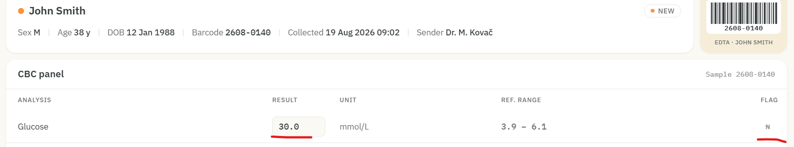

---

## TC16: Verify FLAG value correctly reflects Result vs Ref. Range

| Status | Priority | Severity | Date | Environment |
|--------|----------|----------|------|-------------|
| ❌ Failed | High | High | 21.08.2026 | Browser: Brave, Google Chrome · OS: Windows 11 |

**Connected bugs:** [BR04](bug-reports.md#br04)

**Related test cases:** [TC15](#tc15), [TC21](#tc21)

**Steps to reproduce:**

1. Open sample record 2608-0142 (Ana Marić).
2. For each row, edit the Result value to test the following scenarios:
Enter a value below the Ref. Range.
Enter a value above the Ref. Range.
Enter a value within the Ref. Range.
3. Check the Flag column after each change and verify that the correct flag is displayed:
L = below the Ref. Range
H = above the Ref. Range
N = within the Ref. Range
4. Do the same for sample record 2608-0140 (John Smith)

**Expected result:**

Flag should be "L" when the Result is below the lower Ref. Range limit, "N" when the Result is within the Ref. Range, and "H" when the Result exceeds the upper Ref. Range limit.

**Actual result:**

The flag indicator works correctly for Low, Normal, and High values for all analyses, except for the duplicated upper Glucose field in sample 2608-0142 (covered by TC21/BR07) and the Glucose field in sample 2608-0140. For the Glucose field in both samples, "N" is displayed up to 30.0 and "H" from 30.01, instead of using the defined upper limit of 6.1 (BR04).

**Screenshot:**

---

## TC17: Verify Collected date/time is not later than current system date

| Status | Priority | Severity | Date | Environment |
|--------|----------|----------|------|-------------|
| ❌ Failed | Low | Medium | 21.08.2026 | Browser: Brave, Google Chrome · OS: Windows 11 |

**Connected bugs:** [BR05](bug-reports.md#br05)

**Steps to reproduce:**

1. Open sample record 2608-0142 (Ana Marić)
2. Compare "Collected" value (21 Aug 2026 08:14) with the system date shown top-right

**Expected result:**

Collected date should not be later than the current system date

**Actual result:**

Collected date (21 Aug 2026) is one day after the current system date (20 Aug 2026)

**Screenshot:**

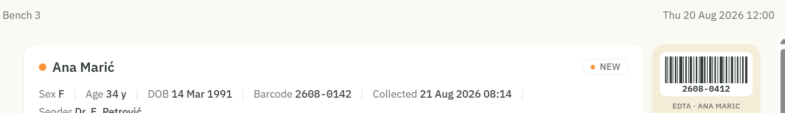

---

## TC18: Verify that age of patients are correctly displayed

| Status | Priority | Severity | Date | Environment |
|--------|----------|----------|------|-------------|
| ❌ Failed | Medium | High | 21.08.2026 | Browser: Brave, Google Chrome · OS: Windows 11 |

**Connected bugs:** [BR06](bug-reports.md#br06)

**Steps to reproduce:**

1. Open sample record 2608-0142
2. Check Age
3. Check DOB
4. Check Date of collection

**Expected result:**

Age is displayed correctly

**Actual result:**

The patient’s age for Sample 2608-0142 is displayed incorrectly. Ana is 35 years old, but the system displays her age as 34.

**Screenshot:**

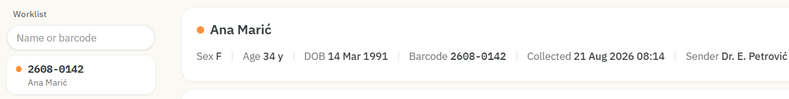

---

## TC19: Verify search field returns correct sample when searching by name

| Status | Priority | Severity | Date | Environment |
|--------|----------|----------|------|-------------|
| ✅ Passed | Medium | Medium | 21.08.2026 | Browser: Brave, Google Chrome · OS: Windows 11 |

**Steps to reproduce:**

1. Click on the search field
2. Enter "Mar" in the search field

**Expected result:**

Samples of patients with "mar" in their name will be displayed

**Actual result:**

Samples of patients with "mar" in their name are displayed

---

## TC20: Verify search field returns correct sample when searching by barcode number

| Status | Priority | Severity | Date | Environment |
|--------|----------|----------|------|-------------|
| ✅ Passed | Medium | Medium | 25.08.2026 | Browser: Brave, Google Chrome · OS: Windows 11 |

**Steps to reproduce:**

1. Click on the search field
2. Enter "0142" in the search field

**Expected result:**

Samples of patients with "0142" in their barcode number will be displayed

**Actual result:**

Samples of patients with "0142" in their barcode number are displayed

---

## TC21: Verify each analysis appears only once per panel

| Status | Priority | Severity | Date | Environment |
|--------|----------|----------|------|-------------|
| ❌ Failed | Medium | Medium | 21.08.2026 | Browser: Brave, Google Chrome · OS: Windows 11 |

**Connected bugs:** [BR07](bug-reports.md#br07)

**Related test cases:** [TC15](#tc15), [TC16](#tc16)

**Steps to reproduce:**

1. Open sample record 2608-0142 (Ana Marić)
2. Review the Analysis column for duplicate entries

**Expected result:**

Each analysis type should appear exactly once in the CBC panel

**Actual result:**

"Glucose" appears twice with different values (18.2 mmol/L and 5.1 mmol/l)

**Screenshot:**

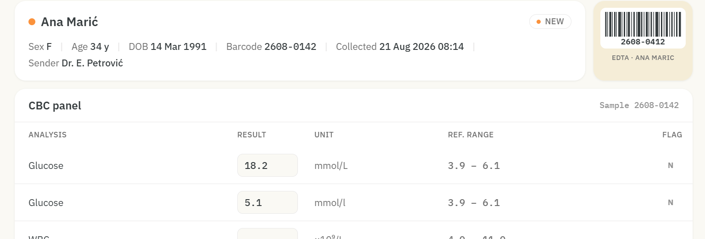

---

## TC22: Verify Ref. Range matches patient's Sex

| Status | Priority | Severity | Date | Environment |
|--------|----------|----------|------|-------------|
| ❌ Failed | High | High | 21.08.2026 | Browser: Brave, Google Chrome · OS: Windows 11 |

**Connected bugs:** [BR08](bug-reports.md#br08)

**Related test cases:** [TC23](#tc23)

**Steps to reproduce:**

1. Open sample record 2608-0142 (Ana Marić), Sex: F
2. Check the Ref. Range sub-label for RBC and Hemoglobin rows

**Expected result:**

Sub-label should read "Adult female" with corresponding female reference values

**Actual result:**

Sub-label reads "Adult male" despite patient being female

**Screenshot:**

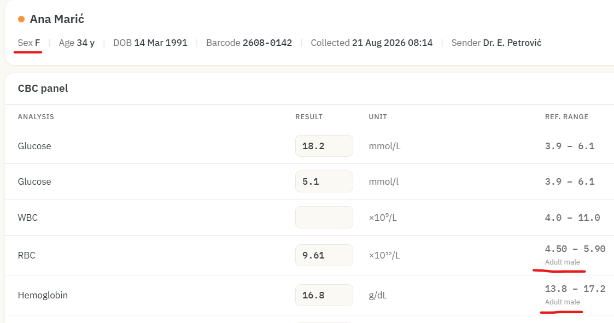

---

## TC23: Verify Flag is correctly applied based on Sex Ref. Range

| Status | Priority | Severity | Date | Environment |
|--------|----------|----------|------|-------------|
| ✅ Passed | High | High | 25.08.2026 | Browser: Brave, Google Chrome · OS: Windows 11 |

**Related test cases:** [TC22](#tc22)

**Steps to reproduce:**

1. Open sample record 2608-0140 Sex: M
2. For RBC and Hemoglobin, note the displayed male Ref. Range
3. Edit the Result value to a value below the lower limit, within the range, and above the upper limit
4. Check the Flag displayed for each Result value
5. Open sample record 2608-0142 Sex: F
6. For RBC and Hemoglobin, note the displayed female Ref. Range
7. Edit the Result value to a value below the lower limit, within the range, and above the upper limit
8. Check the Flag displayed for each Result value

**Expected result:**

Flag should be "L" when the Result is below the lower limit, "N" when the Result is within the displayed sex Ref. Range, and "H" when the Result is above the upper limit.

**Actual result:**

The Sex-specific Ref. Range displayed and the Flag correspond to each other: "L" is displayed when the Result is below the displayed Ref. Range, "N" when it is within the range, and "H" when it is above the displayed Sex Ref. Range.  
For the female patient, the displayed Ref. Range is the Adult male range, but the Flag is correctly calculated based on that displayed range. The incorrect sex Ref. Range for the female patient is covered by TC22

---

## TC24: Verify Save and Approve buttons position while scrolling

| Status | Priority | Severity | Date | Environment |
|--------|----------|----------|------|-------------|
| ❌ Failed | Low | Low | 21.08.2026 | Browser: Brave, Google Chrome · OS: Windows 11 |

**Connected bugs:** [BR09](bug-reports.md#br09)

**Steps to reproduce:**

1. Open a record
2. Scroll down through the page.
3. Observe the position of the Save and Approve buttons.
4. Scroll back to the top of the page.
5. Observe the position of the buttons.

**Expected result:**

Save and Approve buttons should be displayed in the intended position without obstructing the page content while scrolling.

**Actual result:**

Save and Approve buttons remain fixed in the same position while scrolling and can appear in the middle of the page content.

**Screenshot:**

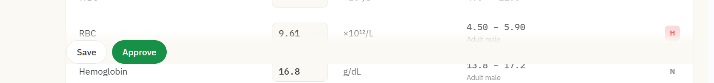

---

## TC25: Verify that a record can be approved when all Result fields are populated

| Status | Priority | Severity | Date | Environment |
|--------|----------|----------|------|-------------|
| ✅ Passed | High | High | 21.08.2026 | Browser: Brave, Google Chrome · OS: Windows 11 |

**Steps to reproduce:**

1. Verify all Result fields are populated
2. Click on Approve button

**Expected result:**

Sample is approved, and a confirmation pop-up message is displayed.

**Actual result:**

Sample is approved, and a confirmation pop-up message is displayed.

---

## TC26: Verify that a sample can't be approved with empty field

| Status | Priority | Severity | Date | Environment |
|--------|----------|----------|------|-------------|
| ❌ Failed | High | High | 21.08.2026 | Browser: Brave, Google Chrome · OS: Windows 11 |

**Connected bugs:** [BR10](bug-reports.md#br10)

**Steps to reproduce:**

1. Leave RBC field empty for sample 2608-0142
2. Click on Approve button

**Expected result:**

Sample isn't approved, and an error pop-up message is displayed.

**Actual result:**

Sample is approved, and a confirmation pop-up message is displayed.

**Screenshot:**

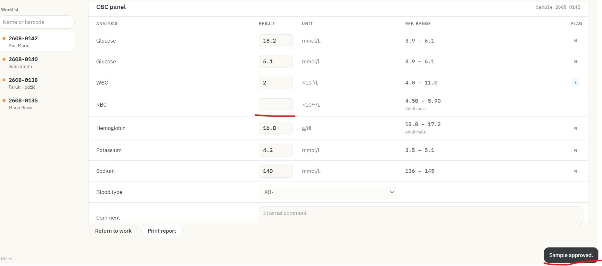

---

## TC27: Verify Results fields are non-editable after sample approval

| Status | Priority | Severity | Date | Environment |
|--------|----------|----------|------|-------------|
| ✅ Passed | Medium | Medium | 22.08.2026 | Browser: Brave, Google Chrome · OS: Windows 11 |

**Related test cases:** [TC50](#tc50), [TC51](#tc51)

**Preconditions:** Sample is in status NEW (not yet approved)

**Steps to reproduce:**

1. Open Sample 2608-0142
2. Click "Approve"
3. Attempt to click and edit the Result field

**Expected result:**

Result field is not editable after approval

**Actual result:**

Result field is not editable after approval

---

## TC28: Verify that the sample status changes after approval

| Status | Priority | Severity | Date | Environment |
|--------|----------|----------|------|-------------|
| ⚠️ Pass with Exception | Low | Medium | 22.08.2026 | Browser: Brave, Google Chrome · OS: Windows 11 |

**Connected bugs:** [BR11](bug-reports.md#br11)

**Steps to reproduce:**

1. Click on the sample 2608-0140
2. Click the Approve button
3. Check the sample status in the upper-right corner of the patient information, verify the color of the dot next to the sample number in the worklist and color of the dot next to the name in Patient information header.

**Expected result:**

The status in the upper-right corner of the patient information is changed from New to Approved. The dot next to the sample number in the worklist changes from orange to green, and the dot next to the patient’s name also changes accordingly.

**Actual result:**

The status in the upper-right corner of the patient information is changed from New to Approved. However, the dot next to the sample number in the worklist does not change from orange to green, and the dot next to the patient’s name also remains unchanged.

**Screenshot:**

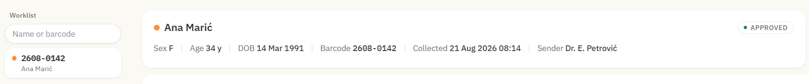

---

## TC29: Verify sample cannot be Approved when a field contains a non-numeric value

| Status | Priority | Severity | Date | Environment |
|--------|----------|----------|------|-------------|
| ❌ Failed | Low | Medium | 25.08.2026 | Browser: Brave, Google Chrome · OS: Windows 11 |

**Connected bugs:** [BR12](bug-reports.md#br12)

**Steps to reproduce:**

1. Click on the sample 2608-0142
2. Enter "te12#$%" in RBC field
3. Click "Approve" button

**Expected result:**

The sample isn't approved because field contains a non-numeric value. An appropriate error message is displayed indicating that the field accepts numeric values only.

**Actual result:**

The sample is approved. Confirmation message is displayed.

**Screenshot:**

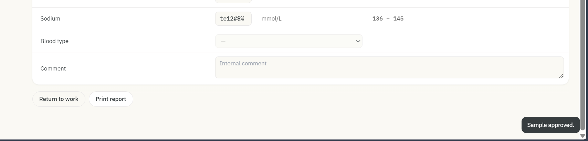

---

## TC30: Verify that "Print" button works properly 

| Status | Priority | Severity | Date | Environment |
|--------|----------|----------|------|-------------|
| ❌ Failed | High | High | 23.08.2026 | Browser: Brave, Google Chrome · OS: Windows 11 |

**Connected bugs:** [BR13](bug-reports.md#br13)

**Steps to reproduce:**

1. Click on the sample 2608-0142
2. Enter "1" in RBC field
3. Enter "22" in WBC field
4. Click on "Save" button
5. Click on "Approve" button
6. Click on "Print" button
7. Check information on pop up window

**Expected result:**

Pop up window is displayed with edited sample 2608-0142

**Actual result:**

Pop up window is displayed with sample 2608-0142 invalid results (shown results were valid before last edit, save and approve)

**Additional notes:**

- The same bug occurs even when the Save button is not clicked before clicking the Approve button.

**Video:** [BR13.mp4](https://github.com/MonikaPejkanovic/manual_testing_project/raw/main/evidence/videos/BR13.mp4)

---

## TC31: Verify that "Return to work" button works properly

| Status | Priority | Severity | Date | Environment |
|--------|----------|----------|------|-------------|
| ✅ Passed | High | High | 23.08.2026 | Browser: Brave, Google Chrome · OS: Windows 11 |

**Steps to reproduce:**

1. Click on the sample 2608-0140
2. Click the Approve button
3. Click on "Return to work" button
4. Click on Result field for RBC
5. Input "4.7"
6. Check if other Result fields are clickable

**Expected result:**

"4.7" is successfully entered after clicking on "Return to work" button and other Result fields are clickable

**Actual result:**

"4.7" is successfully entered after clicking on "Return to work" button and other Result fields are clickable

---

## TC32: Verify that a single edit is saved after Refresh

| Status | Priority | Severity | Date | Environment |
|--------|----------|----------|------|-------------|
| ❌ Failed | High | High | 23.08.2026 | Browser: Brave, Google Chrome · OS: Windows 11 |

**Connected bugs:** [BR14](bug-reports.md#br14)

**Related test cases:** [TC34](#tc34), [TC36](#tc36), [TC45](#tc45), [TC52](#tc52)

**Steps to reproduce:**

1. Open Sample 2608-0140
2. Enter "9" in Potassium field
3. Click on "Save" button
4. Refresh the page

**Expected result:**

"9" is successfully saved and displayed in Potassium field for Sample 2608-0140

**Actual result:**

"9" is not saved; it is displayed in Sample 2608-0142 until another Sample is clicked. After clicking on a different Sample, "9" is no longer displayed in either Sample 2608-0140 or Sample 2608-0142

**Video:** [TC32.mp4](https://github.com/MonikaPejkanovic/manual_testing_project/raw/main/evidence/videos/TC32.mp4)

---

## TC33: Verify that a single edit is retained when navigating away and back (without refresh)

| Status | Priority | Severity | Date | Environment |
|--------|----------|----------|------|-------------|
| ❌ Failed | High | High | 23.08.2026 | Browser: Brave, Google Chrome · OS: Windows 11 |

**Connected bugs:** [BR15](bug-reports.md#br15), [BR03](bug-reports.md#br03)

**Related test cases:** [TC12](#tc12), [TC35](#tc35), [TC37](#tc37), [TC44](#tc44), [TC48](#tc48)

**Steps to reproduce:**

1. Open Sample 2608-0140
2. Enter "9" in Potassium field
3. Click on "Save" button
4. Click on Sample 2608-0142
5. Go back to Sample 2608-0140

**Expected result:**

"9" is successfully saved and displayed in Potassium field for Sample 2608-0140

**Actual result:**

"9" is saved and displayed for Potassium in both Sample 2608-0140 and Sample 2608-0142. But it is reverted to its previous value once a second edit is made.

**Additional notes:**

- If a further cycle is performed after this, editing a second field (e.g., Sodium) on the same sample (2608-0140), clicking Save, navigating to a different sample, and returning, only the most recently saved field (Sodium) is retained, while the previously retained field (Potassium) reverts/disappears.

**Video:** [TC33.mp4](https://github.com/MonikaPejkanovic/manual_testing_project/raw/main/evidence/videos/TC33.mp4)

---

## TC34: Verify that multiple edits on the same sample are all saved after Refresh

| Status | Priority | Severity | Date | Environment |
|--------|----------|----------|------|-------------|
| ❌ Failed | High | High | 25.08.2026 | Browser: Brave, Google Chrome · OS: Windows 11 |

**Connected bugs:** [BR14](bug-reports.md#br14)

**Related test cases:** [TC32](#tc32), [TC36](#tc36), [TC45](#tc45), [TC52](#tc52)

**Steps to reproduce:**

1. Open Sample 2608-0140
2. Enter "1" in Glucose field
3. Enter "2" in Potassium field
4. Enter "3" in Sodium field
5. Click on "Save" button
6. Refresh the page

**Expected result:**

All three edits are successfully saved and displayed in the correct sample and field.

**Actual result:**

All three edits are shown in Sample 2608-0142, but none of them are shown in Sample 2608-0140 where they should be saved. After clicking on a different Sample, edits are no longer displayed in either Sample 2608-0140 or Sample 2608-0142

**Video:** [TC34.mp4](https://github.com/MonikaPejkanovic/manual_testing_project/raw/main/evidence/videos/TC34.mp4)

---

## TC35: Verify that multiple edits on the same sample are all retained without Refresh

| Status | Priority | Severity | Date | Environment |
|--------|----------|----------|------|-------------|
| ❌ Failed | High | High | 25.08.2026 | Browser: Brave, Google Chrome · OS: Windows 11 |

**Connected bugs:** [BR15](bug-reports.md#br15), [BR03](bug-reports.md#br03)

**Related test cases:** [TC33](#tc33), [TC12](#tc12), [TC37](#tc37), [TC44](#tc44), [TC48](#tc48)

**Steps to reproduce:**

1. Open Sample 2608-0140
2. Enter "1" in Glucose field
3. Enter "2" in Potassium field
4. Enter "3" in Sodium field
5. Click on "Save" button
6. Click on Sample 2608-0142
7. Go back to Sample 2608-0140

**Expected result:**

All three edits are successfully saved and displayed in the correct sample and field.

**Actual result:**

Only last edit is saved and displayed in sample 2608-0140 but it is also shown in sample 2608-0142

---

## TC36: Verify that multiple edits across samples are saved independently after Refresh

| Status | Priority | Severity | Date | Environment |
|--------|----------|----------|------|-------------|
| ❌ Failed | High | High | 25.08.2026 | Browser: Brave, Google Chrome · OS: Windows 11 |

**Connected bugs:** [BR14](bug-reports.md#br14)

**Related test cases:** [TC32](#tc32), [TC34](#tc34), [TC45](#tc45), [TC52](#tc52)

**Steps to reproduce:**

1. Open Sample 2608-0142 , edit a field, click Save
2. Refresh the page
3. Open Sample 2608-0140, edit a field, click Save
4. Refresh the page

**Expected result:**

Each sample displays only the edit made on that specific sample.

**Actual result:**

After editing the first sample ( 2608-0142) and refreshing the page, the edit is displayed correctly. However, after editing the second sample (2608-0140) and refreshing the page, the edit made to the second sample is displayed in the first sample, while the edit made to the first sample disappears. When navigating to the second sample afterward, the edit made there is not displayed at all.

**Video:** [TC36.mp4](https://github.com/MonikaPejkanovic/manual_testing_project/raw/main/evidence/videos/TC36.mp4)

---

## TC37: Verify that multiple edits across samples are retained independently without Refresh

| Status | Priority | Severity | Date | Environment |
|--------|----------|----------|------|-------------|
| ❌ Failed | High | High | 25.08.2026 | Browser: Brave, Google Chrome · OS: Windows 11 |

**Connected bugs:** [BR15](bug-reports.md#br15), [BR03](bug-reports.md#br03)

**Related test cases:** [TC33](#tc33), [TC35](#tc35), [TC12](#tc12), [TC44](#tc44), [TC48](#tc48)

**Steps to reproduce:**

1. Open Sample 2608-0140 , edit a field, click Save
2. Open Sample 2608-0142, edit a field, click Save
3. Open Sample 2608-0140 and verify that first edit is shown
4. Open Sample 2608-0142 and verify that second edit is shown

**Expected result:**

Each sample displays only the edit made on that specific sample.

**Actual result:**

After the first sample was edited, the edit could also be seen on the second sample. After the second sample was edited, the first edit was no longer visible on the first sample, while the second edit could be seen there. When returning to the second sample, the second edit was still visible.

**Additional notes:**

- When another edit is made afterward, the second edit disappears. The save operation only retains the most recent change.

**Video:** [TC37.mp4](https://github.com/MonikaPejkanovic/manual_testing_project/raw/main/evidence/videos/TC37.mp4)

---

## TC38: Verify data consistency of results list after page reload

| Status | Priority | Severity | Date | Environment |
|--------|----------|----------|------|-------------|
| ✅ Passed | Medium | High | 25.08.2026 | Browser: Brave, Google Chrome · OS: Windows 11 |

**Steps to reproduce:**

1. Open Sample 2608-0140
2. Record results
3. Perform a hard refresh of the page (Ctrl+F5)
4. Wait for the page to fully load
5. Compare the result with the one recorded in step 2

**Expected result:**

After refresh everything is as it was before refresh

**Actual result:**

After refresh everything is as it was before refresh

---

## TC39: Verify data consistency of results list after editing, saving, and refreshing the page

| Status | Priority | Severity | Date | Environment |
|--------|----------|----------|------|-------------|
| ❌ Failed | High | High | 25.08.2026 | Browser: Brave, Google Chrome · OS: Windows 11 |

**Connected bugs:** [BR16](bug-reports.md#br16)

**Steps to reproduce:**

1. Open Sample 2608-0142
2. Edit Sodium field, enter "130"
3. Click Save
4. Record results
5. Perform a hard refresh of the page (Ctrl+F5)
6. Wait for the page to fully load
7. Compare the result with the one recorded in step 4

**Expected result:**

After refresh everything is as it was before refresh

**Actual result:**

RBC field had a value of 5.61 and the Hemoglobin field had 16.8 before the refresh. After the refresh, the values swapped fields, RBC now shows 16.8, and Hemoglobin shows 5.61.

**Additional notes:**

- This bug occurs with both a hard refresh (Ctrl+F5) and a regular refresh (F5), the field values swap in both cases, as long as a field was edited and saved beforehand.
- This bug also occurs on Sample 2608-0142, even when the edit was made and saved on a different sample (2608-0140).

**Video:** [BR16.mp4](https://github.com/MonikaPejkanovic/manual_testing_project/raw/main/evidence/videos/BR16.mp4)

---

## TC40: Verify edits in Tab 1 on Sample A do not leak into Tab 2 on Sample B

| Status | Priority | Severity | Date | Environment |
|--------|----------|----------|------|-------------|
| ✅ Passed | High | High | 25.08.2026 | Browser: Brave, Google Chrome · OS: Windows 11 |

**Preconditions:** App is open in two browser tabs

**Steps to reproduce:**

1. Open the app in Tab 1
2. Open a new tab (Tab 2) and open the app in it
3. In Tab 2, open Sample  2608-0140  (B) and record its current field values
4. In Tab 1, open Sample 2608-0142 (A) and edit a Result field (do not save)
5. Switch to Tab 2 (without refreshing) and check if Sample B's values changed, record result
6. In Tab 1, save the edit
7. Switch to Tab 2 again (without refreshing) and check if Sample B's values changed, record result
8. In Tab 2, perform a hard refresh (Ctrl+F5)
9. Compare Sample B's values with the baseline recorded in step 3

**Expected result:**

Sample B in Tab 2 is never affected by unsaved or saved edits made to Sample A in Tab 1

**Actual result:**

Sample B in Tab 2 is never affected by unsaved or saved edits made to Sample A in Tab 1

---

## TC41: Verify edits in Browser 1 on Sample A do not leak into Browser 2 on Sample B

| Status | Priority | Severity | Date | Environment |
|--------|----------|----------|------|-------------|
| ✅ Passed | High | High | 25.08.2026 | Browser: Brave, Google Chrome · OS: Windows 11 |

**Preconditions:** App is open in two different browsers (Chrome and Brave)

**Steps to reproduce:**

1. Open the app in Browser 1
2. Open the app in Browser 2
3. In Browser 2, open Sample 2608-0140 (B) and record its current field values
4. In Browser 1, open Sample 2608-0142 (A) and edit a Result field (do not save)
5. Switch to Browser 2 (without refreshing) and check if Sample B's values changed, record result
6. In Browser 1, save the edit
7. Switch to Browser 2 (without refreshing) and check if Sample B's values changed, record result
8. In Browser 2, perform a hard refresh (Ctrl+F5)
9. Compare Sample B's values with the baseline recorded in step 3

**Expected result:**

Sample B in Browser 2 is never affected by unsaved or saved edits made to Sample A in Browser 1

**Actual result:**

Sample B in Browser 2 is never affected by unsaved or saved edits made to Sample A in Browser 1

---

## TC42: Verify Tab 2 pulls the latest saved value after refresh when the same sample is edited in Tab 1

| Status | Priority | Severity | Date | Environment |
|--------|----------|----------|------|-------------|
| ❌ Failed | High | High | 25.08.2026 | Browser: Brave, Google Chrome · OS: Windows 11 |

**Connected bugs:** [BR17](bug-reports.md#br17)

**Related test cases:** [TC46](#tc46)

**Preconditions:** App is open in two browser tabs

**Steps to reproduce:**

1. Open the app in tab 1
2. Open a new tab (tab 2) and open the app in it
3. In both tab 1 and tab 2, open the same Sample 2608-0140
4. In Tab 1, edit a Result field (e.g., RBC), do not save yet
5. Switch to Tab 2 (without refreshing) and check if the field shows Tab 1's unsaved edit. record result
6. In Tab 1, save the edit
7. Switch to Tab 2 (without refreshing) and check if the field shows the saved value, record result
8. In tab 2, perform a hard refresh (Ctrl+F5)
9. Check if tab 2 now shows the updated value

**Expected result:**

After refresh, tab 2 shows the value saved in tab 1

**Actual result:**

After refresh, Tab 2 does not show the updated value saved in Tab 1, the field still displays the old value.

**Video:** [BR17.mp4](https://github.com/MonikaPejkanovic/manual_testing_project/raw/main/evidence/videos/BR17.mp4)

---

## TC43: Verify Browser 2 pulls the latest saved value after refresh when the same sample is edited in Browser 1

| Status | Priority | Severity | Date | Environment |
|--------|----------|----------|------|-------------|
| ❌ Failed | High | High | 25.08.2026 | Browser: Brave, Google Chrome · OS: Windows 11 |

**Connected bugs:** [BR18](bug-reports.md#br18)

**Related test cases:** [TC47](#tc47)

**Preconditions:** App is open in two different browsers (Chrome and Brave)

**Steps to reproduce:**

1. Open the app in browser 1
2. Open the app in browser 2
3. In both browsers, open the same Sample 2608-0140
4. In Browser 1, edit a Result field (e.g., RBC), do not save
5. Switch to Browser 2 (without refreshing) and check if the field shows Browser 1's unsaved edit, record result
6. In Browser 1, save the edit
7. Switch to Browser 2 (without refreshing) and check if the field shows the saved value, record result
8. In browser 2, perform a hard refresh (Ctrl+F5)
9. Check if browser 2 now shows the updated value

**Expected result:**

After refresh, browser 2 shows the value saved in Tab 1

**Actual result:**

After refresh, Browser 2 does not show the updated value saved in Browser 1, the field still displays the old value.

**Video:** [BR18.mp4](https://github.com/MonikaPejkanovic/manual_testing_project/raw/main/evidence/videos/BR18.mp4)

---

## TC44: Verify that all sequential single-field edit/save cycles are retained on the same sample (without refresh)

| Status | Priority | Severity | Date | Environment |
|--------|----------|----------|------|-------------|
| ❌ Failed | High | High | 26.08.2026 | Browser: Brave, Google Chrome · OS: Windows 11 |

**Connected bugs:** [BR15](bug-reports.md#br15), [BR03](bug-reports.md#br03)

**Related test cases:** [TC33](#tc33), [TC35](#tc35), [TC37](#tc37), [TC12](#tc12), [TC48](#tc48)

**Steps to reproduce:**

1. Open Sample 2608-0140
2. Enter "9" in Potassium field
3. Click "Save"
4. Click on Sample 2608-0142
5. Go back to Sample 2608-0140 (verify Potassium = 9)
6. Enter a value in Sodium field
7. Click "Save"
8. Click on Sample 2608-0142
9. Go back to Sample 2608-0140

**Expected result:**

Both Potassium AND Sodium edits are retained together

**Actual result:**

After editing and saving Potassium, navigating to Sample 2608-0142 and back, Potassium value is correctly retained. After then editing and saving Sodium field and navigating away and back again, only the Sodium value is present, the previously saved Potassium value is lost/reverted.  
Additionally, on both occasions, the edit made on Sample 2608-0140 leaked into Sample 2608-0142 as well.

**Video:** [TC44.mp4](https://github.com/MonikaPejkanovic/manual_testing_project/raw/main/evidence/videos/TC44.mp4)

---

## TC45: Verify sequential single-field edit/save cycles are all retained with a refresh between each cycle

| Status | Priority | Severity | Date | Environment |
|--------|----------|----------|------|-------------|
| ❌ Failed | High | High | 26.08.2026 | Browser: Brave, Google Chrome · OS: Windows 11 |

**Connected bugs:** [BR14](bug-reports.md#br14)

**Related test cases:** [TC32](#tc32), [TC34](#tc34), [TC36](#tc36), [TC52](#tc52)

**Steps to reproduce:**

1. Open Sample 2608-0140
2. Enter a value in Potassium field
3. Click "Save"
4. Perform a hard refresh (Ctrl+F5)
5. Verify Potassium value is retained
6. Enter a value in Sodium field
7. Click "Save"
8. Perform a hard refresh (Ctrl+F5)

**Expected result:**

Both Potassium and Sodium values are present together after refresh

**Actual result:**

Neither Potassium nor Sodium value is saved to Sample 2608-0140. After each refresh, the value appears instead on Sample 2608-0142 (the default/first-loaded sample). One value per refresh cycle (Potassium appears on 2608-0142 after the first refresh, Sodium appears on 2608-0142 after the second refresh), rather than either being retained on 2608-0140 where they were actually entered.

**Video:** [TC45.mp4](https://github.com/MonikaPejkanovic/manual_testing_project/raw/main/evidence/videos/TC45.mp4)

---

## TC46: Verify behavior when the same field on the same sample is edited and saved concurrently from two tabs

| Status | Priority | Severity | Date | Environment |
|--------|----------|----------|------|-------------|
| ❌ Failed | High | High | 26.08.2026 | Browser: Brave, Google Chrome · OS: Windows 11 |

**Connected bugs:** [BR14](bug-reports.md#br14), [BR17](bug-reports.md#br17)

**Related test cases:** [TC42](#tc42)

**Preconditions:** App is open in two browser tabs

**Steps to reproduce:**

1. Open the app in Tab 1 and Tab 2
2. In both tabs, open Sample 2608-0140
3. In Tab 1, enter "1" in Sodium field, click "Save"
4. In Tab 2 (without refreshing beforehand), enter "6" in Sodium field, click "Save"
5. Refresh both tabs
6. Check the final Sodium value in both tabs

**Expected result:**

The last write is displayed (Sodium=6) and both tabs display the same value

**Actual result:**

After refreshing both tabs, neither tab shows the Sodium edited value on Sample 2608-0140, where it was actually entered and saved. Instead, each tab's edited value appears on Sample 2608-0142 (the default/first-loaded sample), consistent with BR14. This also means neither tab correctly picks up the other's saved value on Sample 2608-0140, consistent with BR17.

**Video:** [TC46.mp4](https://github.com/MonikaPejkanovic/manual_testing_project/raw/main/evidence/videos/TC46.mp4)

---

## TC47: Verify behavior when the same field on the same sample is edited and saved concurrently from two browsers

| Status | Priority | Severity | Date | Environment |
|--------|----------|----------|------|-------------|
| ❌ Failed | High | High | 26.08.2026 | Browser: Brave, Google Chrome · OS: Windows 11 |

**Connected bugs:** [BR14](bug-reports.md#br14), [BR18](bug-reports.md#br18)

**Related test cases:** [TC43](#tc43)

**Preconditions:** App is open in two different browsers (Chrome and Brave)

**Steps to reproduce:**

1. Open the app in Browser 1 and Browser2
2. In both browsers, open Sample 2608-0140
3. In Browser 1, enter "1" in Sodium field, click "Save"
4. In Browser 2 (without refreshing beforehand), enter "6" in Sodium field, click "Save"
5. Refresh both browsers
6. Check the final Sodium value in both browsers

**Expected result:**

The last write is displayed (Sodium=6) and both browsers display the same value

**Actual result:**

After refreshing both browsers, neither browser shows the Sodium edited value on Sample 2608-0140, where it was actually entered and saved. Instead, each tab's edited value appears on Sample 2608-0142 (the default/first-loaded sample), consistent with BR14. This also means neither browser correctly picks up the other's saved value on Sample 2608-0140, consistent with BR18.

**Video:** [TC47.mp4](https://github.com/MonikaPejkanovic/manual_testing_project/raw/main/evidence/videos/TC47.mp4)

---

## TC48: Verify that an unsaved edit is discarded when navigating away and back without clicking Save

| Status | Priority | Severity | Date | Environment |
|--------|----------|----------|------|-------------|
| ❌ Failed | High | High | 26.08.2026 | Browser: Brave, Google Chrome · OS: Windows 11 |

**Connected bugs:** [BR03](bug-reports.md#br03)

**Related test cases:** [TC12](#tc12), [TC35](#tc35), [TC33](#tc33), [TC37](#tc37), [TC44](#tc44)

**Steps to reproduce:**

1. Open Sample 2608-0140, note current Sodium value
2. Edit Sodium field to a new value (don't click Save)
3. Click on Sample 2608-0142
4. Go back to Sample 2608-0140

**Expected result:**

Sodium field reverts to its original, previously saved value, the unsaved edit is discarded

**Actual result:**

The unsaved edit was not discarded, the new Sodium value was retained on Sample 2608-0140 even without clicking Save, and also leaked into Sample 2608-0142.

---

## TC49: Verify clicking Save with no changes made does not cause errors or unintended side effects

| Status | Priority | Severity | Date | Environment |
|--------|----------|----------|------|-------------|
| ✅ Passed | Low | Low | 26.08.2026 | Browser: Brave, Google Chrome · OS: Windows 11 |

**Steps to reproduce:**

1. Open Sample 2608-0140
2. Without editing any field, click "Save"
3. Observe system response

**Expected result:**

No error occurs

**Actual result:**

No error occurs

---

## TC50: Verify Blood type is non-editable after sample approval

| Status | Priority | Severity | Date | Environment |
|--------|----------|----------|------|-------------|
| ✅ Passed | Medium | Medium | 26.08.2026 | Browser: Brave, Google Chrome · OS: Windows 11 |

**Related test cases:** [TC27](#tc27), [TC51](#tc51)

**Preconditions:** Sample is in status NEW (not yet approved)

**Steps to reproduce:**

1. Open Sample 2608-0142
2. Click "Approve"
3. Attempt to click and edit the Blood type dropdown

**Expected result:**

Both Blood type field is not editable after approval, consistent with Result field behavior (see TC27)

**Actual result:**

Both Blood type field is not editable after approval, consistent with Result field behavior (see TC27)

---

## TC51: Verify Comment field is non-editable after sample approval

| Status | Priority | Severity | Date | Environment |
|--------|----------|----------|------|-------------|
| ✅ Passed | Medium | Medium | 26.08.2026 | Browser: Brave, Google Chrome · OS: Windows 11 |

**Related test cases:** [TC27](#tc27), [TC50](#tc50)

**Preconditions:** Sample is in status NEW (not yet approved)

**Steps to reproduce:**

1. Open Sample 2608-0142
2. Click "Approve"
3. Attempt to click and edit the Comment field

**Expected result:**

Comment field is not editable after approval, consistent with Result and Blood type field behavior (see TC27 and TC50)

**Actual result:**

Comment field is not editable after approval, consistent with Result and Blood type field behavior (see TC27 and TC50)

---

## TC52: Verify refreshing the page immediately after clicking Save does not cause data loss

| Status | Priority | Severity | Date | Environment |
|--------|----------|----------|------|-------------|
| ❌ Failed | High | High | 26.08.2026 | Browser: Brave, Google Chrome · OS: Windows 11 |

**Connected bugs:** [BR14](bug-reports.md#br14)

**Related test cases:** [TC32](#tc32), [TC34](#tc34), [TC36](#tc36), [TC45](#tc45)

**Steps to reproduce:**

1. Open Sample 2608-0140
2. Edit a Result field
3. Click "Save" and immediately (within ~1 second) perform a hard refresh
4. Check whether the edit was saved

**Expected result:**

The save completes and the value persists

**Actual result:**

The edit was saved, but after refresh it appeared on Sample 2608-0142 (the default/first-loaded sample) instead of Sample 2608-0140, where it was actually entered and saved. After navigating from 2608-0142 to 2608-0140 and back, the edit is lost.

---

## TC53: Verify sample cannot be approved when a field contains negative numeric value

| Status | Priority | Severity | Date | Environment |
|--------|----------|----------|------|-------------|
| ❌ Failed | High | High | 26.08.2026 | Browser: Brave, Google Chrome · OS: Windows 11 |

**Connected bugs:** [BR19](bug-reports.md#br19)

**Steps to reproduce:**

1. Open sample record 2608-0140 (John Smith)
2. Click on Sodium Result field
3. Enter "-5"
4. Observe field value and Flag column
5. Click "Save" button
6. Refresh the page and verify persisted value
7. Click "Approve" button

**Expected result:**

Field should reject the negative value immediately with a validation error (numeric values must be ≥ 0), or if entered, Save/Approve should be blocked with an appropriate error message

**Actual result:**

"-5" is accepted in the field, sample is approved. Confirmation message is displayed.

**Screenshot:**

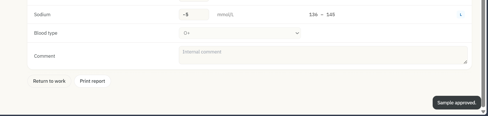

---
